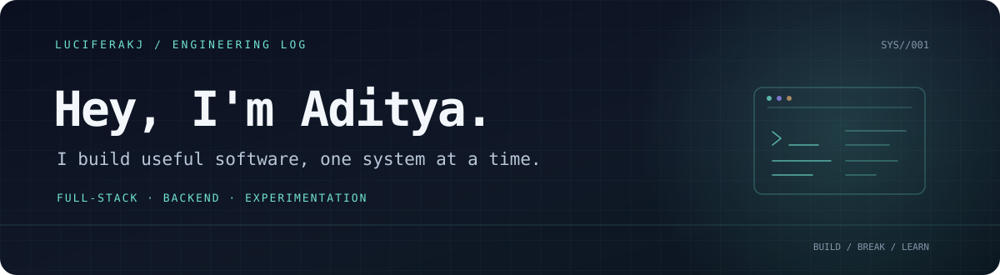

<!-- Profile README for github.com/LuciferAKJ -->

  

  <a href="https://github.com/LuciferAKJ">GitHub</a>
  &nbsp;·&nbsp;
  <a href="https://github.com/LuciferAKJ?tab=repositories">Repositories</a>
  &nbsp;·&nbsp;
  <a href="https://sih-thermal-intel.vercel.app">FireSense live platform</a>

## About

I'm **Aditya**, a developer who enjoys turning practical ideas into complete software products. I work across frontend, backend, and data layers, with a particular interest in **backend architecture, real-time applications, and data-rich interfaces**.

I like understanding a problem end to end: shaping the user experience, designing the API, working with data, and refining the details that make a product useful and reliable.

## Selected work

<table>
  <tr>
    <td width="50%" valign="top">
      <h3>01 / FireSense</h3>
      
Satellite thermal intelligence and incident-response platform that combines NASA FIRMS data with geospatial context, risk analysis, and operational dashboards.

      
Python · NASA FIRMS · Geospatial data · Web dashboard

      <a href="https://github.com/LuciferAKJ/sih-thermal-intel">Repository ↗</a>
      &nbsp;·&nbsp;
      <a href="https://sih-thermal-intel.vercel.app">Live platform ↗</a>
    </td>
    <td width="50%" valign="top">
      <h3>02 / EchoRoom</h3>
      
An anonymous community platform for sharing thoughts, discovering relatable perspectives, and joining real-time conversations.

      
React · Node.js · Express · MongoDB · Socket.IO

      <a href="https://github.com/LuciferAKJ/EchoRoom">Explore repository ↗</a>
    </td>
  </tr>
  <tr>
    <td width="50%" valign="top">
      <h3>03 / ClipDrop</h3>
      
A temporary clipboard and file-sharing service with expiring shares, protected links, and optional cross-device clipboard synchronization.

      
Next.js · TypeScript · Prisma · PostgreSQL · Clerk

      <a href="https://github.com/LuciferAKJ/clipdrop">Explore repository ↗</a>
    </td>
    <td width="50%" valign="top">
      <h3>04 / GeoGuesser</h3>
      
A geography guessing game built around location imagery, interactive maps, player accounts, and a scoring-oriented backend.

      
Java · Spring Boot · PostgreSQL · Leaflet · Mapbox

      <a href="https://github.com/LuciferAKJ/GeoGuesser">Explore repository ↗</a>
    </td>
  </tr>
  <tr>
    <td width="50%" valign="top">
      <h3>05 / F1 Race Replay</h3>
      
An interactive Formula 1 race replay and telemetry dashboard using real session data, synchronized playback, and race analytics.

      
Next.js · Python · FastAPI · FastF1 · PixiJS

      <a href="https://github.com/LuciferAKJ/F1">Explore repository ↗</a>
    </td>
    <td width="50%" valign="top">
      <h3>More experiments</h3>
      
Smaller builds and experiments help me explore ideas, practise fundamentals, and learn new tools.

      
Learning by building · Iteration · Exploration

      <a href="https://github.com/LuciferAKJ?tab=repositories">Browse all repositories ↗</a>
    </td>
  </tr>
</table>

## Toolkit

**Languages**

  

**Frontend**

  

**Backend & data**

  

**Tools**

  

## What I enjoy building

- **Full-stack products** — applications where the frontend, API, and data model work together cleanly.
- **Backend systems** — APIs, authentication, real-time communication, and thoughtful application architecture.
- **Data-rich experiences** — maps, dashboards, telemetry, and interfaces that make complex information easier to understand.

---

  Thanks for visiting. I'm always learning, building, and refining.
   
  <strong>BUILD WITH PURPOSE · KEEP ITERATING</strong>

